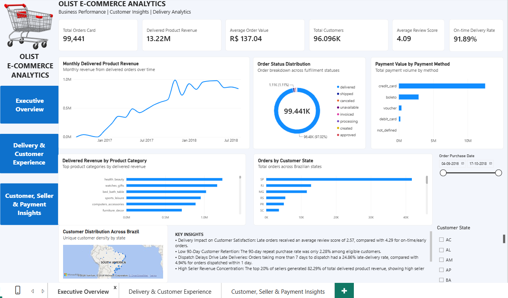

# Olist E-Commerce Sales, Logistics & Customer Experience Analytics

End-to-end Data Analytics portfolio project analyzing **100,000+ orders** from the Brazilian E-Commerce Public Dataset by Olist. This project combines **Python** data preparation, **MySQL** business validation queries, and an interactive **3-page Power BI executive dashboard** to uncover revenue drivers, delivery bottlenecks, and customer satisfaction insights.

---

## Dashboard Preview & Interactive Access

* **Interactive Power BI File (`.pbix`):** [Download from Google Drive](https://drive.google.com/file/d/17R2S1cSdnW3uKEB_E_rHELiPdoYqn3vQ/view?usp=sharing)
* **Full 3-Page Dashboard Report (PDF):** [`Olist_Ecommerce_Analysis_Dashboard.pdf`](Olist_Ecommerce_Analysis_Dashboard.pdf)

### Executive Overview

---

## Business Objectives & Key Analytical Themes

1. **Revenue & Order Growth:** Track total GMV, order volume, average order value (AOV), and monthly sales trends across product categories.
2. **Delivery & Logistics Performance:** Measure actual vs. estimated delivery times, late-delivery rates, and freight cost impact across Brazilian states.
3. **Customer Satisfaction & Review Drivers:** Quantify how delivery delays directly degrade customer review scores (1–5 stars).
4. **Customer Retention & Behavior:** Analyze repeat purchase rates vs. one-time buyers across regions.
5. **Seller Performance:** Evaluate top-performing sellers by revenue, order fulfillment speed, and average rating.
6. **Payment Methods & Installments:** Break down customer payment preferences (credit card, boleto, voucher, debit) and installment behavior.

---

## Tech Stack & Repository Files

* **Data Cleaning & Exploratory Analysis:** [`python/analysis.py`](python/analysis.py) (`pandas`, `numpy`)
* **Business Validation Queries:** [`sql/Olist_Final_Business_Findings.sql`](sql/Olist_Final_Business_Findings.sql) (MySQL `JOIN`s, CTEs, Window Functions, Aggregations)
* **Dashboard & Visuals:** [`Olist_Ecommerce_Analysis_Dashboard.pdf`](Olist_Ecommerce_Analysis_Dashboard.pdf), page PNG screenshots (`01`–`03`), and full `.pbix` model on Google Drive

---

## Dataset Source

* **Dataset:** [Brazilian E-Commerce Public Dataset by Olist (Kaggle)](https://www.kaggle.com/datasets/olistbr/brazilian-ecommerce)
* **Schema Used:** `olist_orders_dataset`, `olist_order_items_dataset`, `olist_products_dataset`, `olist_order_reviews_dataset`, `olist_sellers_dataset`, `olist_order_payments_dataset`, `olist_customers_dataset`, and `product_category_name_translation`.

---

## How to Reproduce

1. Download the raw CSV files from the Kaggle dataset link above.
2. Run [`python/analysis.py`](python/analysis.py) to clean and preprocess the relational tables.
3. Execute [`sql/Olist_Final_Business_Findings.sql`](sql/Olist_Final_Business_Findings.sql) in MySQL to validate all 6 core business metrics.
4. Download the `.pbix` file via the Google Drive link above and open it in **Power BI Desktop** to explore interactive filters and DAX measures.
